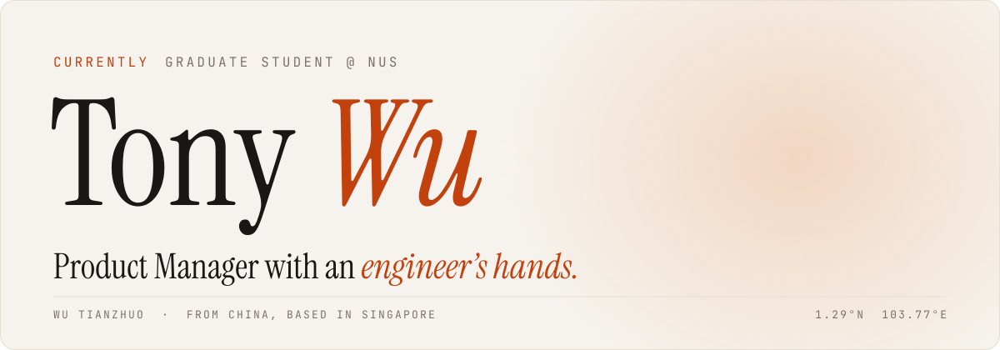

<a href="https://me.tonywu.top">
  <picture>
    <source media="(prefers-color-scheme: dark)" srcset="assets/header-dark.svg">
    
  </picture>
</a>

  
  
  
  

  <i>I design and build <b>AI products</b> — from user research all the way down to the code.</i>

 

### `01` About

Hi, I'm Tony (Wu Tianzhuo · 吴天卓). I work where product meets engineering: I talk to users, write the PRD, then help build it.

Currently a graduate student at **NUS**, contributing to open-source AI tooling on the side.

| From | Based in | Studying | Focus | Languages |
| :-- | :-- | :-- | :-- | :-- |
| 🇨🇳 China | 🇸🇬 Singapore | NUS | AI Products · RAG · Agents | Mandarin · English |

### `02` Open Source

| Project | ★ | Contribution |
| :-- | --: | :-- |
| [rea](https://github.com/morluto/rea/pulls?q=is%3Apr+author%3ATonyWu2333+is%3Amerged) | 350k+ | Agent-driven reverse engineering toolkit — classify ReadyToRun images as modern .NET ([#2075](https://github.com/morluto/rea/pull/2075)), name Mach-O build-version platforms ([#2065](https://github.com/morluto/rea/pull/2065)), skip NIB tests without `ibtool` ([#2070](https://github.com/morluto/rea/pull/2070)). |
| [Ponytail](https://github.com/DietrichGebert/ponytail/pull/1025) | 170k+ | Plugin that makes AI coding agents favour the simplest solution — isolated the Python helper's tests from the developer's own config. |
| [grpc-gateway](https://github.com/grpc-ecosystem/grpc-gateway/pull/7484) | 20k+ | OpenAPI generator now honours the `required` field option on repeated fields. |
| [SurfSense](https://github.com/MODSetter/SurfSense/pull/2203) | 16k+ | Local script tracebacks print relative to their run folder, so errors point at the right file. |
| [isomorphic-git](https://github.com/isomorphic-git/isomorphic-git/pull/2444) | 8.3k+ | `cherry-pick` refuses to run over local changes — uncommitted work is never overwritten. |
| [tabularis](https://github.com/TabularisDB/tabularis/pull/900) | 5.2k+ | `EXPLAIN ANALYZE` off by default for data-modifying statements, so explaining never changes data. |
| [token-monitor](https://github.com/Javis603/token-monitor/pull/852) | 3.1k+ | OpenRouter key-limit tracking measures a resetting limit against its current period. |
| [dsh-im](https://github.com/xmanrui/dsh-im/pull/265) | 2.0k+ | Feishu live process messages stay inside their topic thread. |
| [dsh-plugin-radar](https://github.com/AdamPlatin123/dsh-plugin-radar/pull/818) | 1.4k+ | `classify.py` CLI lists all 13 taxonomy domains with their real definitions. |
| [AgentRQ](https://github.com/agentrq/agentrq/pulls?q=is%3Apr+author%3ATonyWu2333+is%3Amerged) | 1.1k+ | Human-in-the-loop task manager for AI agents — shared loading spinner ([#316](https://github.com/agentrq/agentrq/pull/316)), popover fix ([#328](https://github.com/agentrq/agentrq/pull/328)), Chinese README ([#209](https://github.com/agentrq/agentrq/pull/209)). |
| [druk](https://github.com/letstri/druk/pull/108) | 780+ | Diff view marks a missing final newline wherever the last line appears. |
| [CampusLink](https://github.com/t2047/CampusLink) | — | NUS team project, an AI campus workspace — product manager, and built the mail & calendar agent module. |
| [AI Wellness App](https://github.com/TonyWu2333/AI-Wellness-Mobile-App) | — | Maintainer of an Android wellness assistant backed by a RAG agent over a medical knowledge base. |
| [webstack-modern](https://github.com/TonyWu2333/webstack-modern) | — | Author of a beautified WebStack link-navigation site with dark mode, deployed on Vercel. |

### `03` GitHub Stats

  <picture>
    <source media="(prefers-color-scheme: dark)" srcset="https://github-readme-stats.vercel.app/api?username=TonyWu2333&show_icons=true&include_all_commits=true&border_radius=12&disable_animations=true&bg_color=14110F&title_color=E8743B&text_color=F2EDE6&icon_color=E8743B&border_color=2A2521&ring_color=E8743B">
    
  </picture>
  <picture>
    <source media="(prefers-color-scheme: dark)" srcset="https://github-readme-stats.vercel.app/api/top-langs/?username=TonyWu2333&layout=compact&langs_count=6&hide=html,css,stylus,ejs,scss,less,pug,batchfile&border_radius=12&disable_animations=true&bg_color=14110F&title_color=E8743B&text_color=F2EDE6&icon_color=E8743B&border_color=2A2521&ring_color=E8743B">
    
  </picture>

  <picture>
    <source media="(prefers-color-scheme: dark)" srcset="https://streak-stats.demolab.com?user=TonyWu2333&border_radius=12&disable_animations=true&background=14110F&border=2A2521&ring=E8743B&fire=E8743B&currStreakNum=F2EDE6&sideNums=F2EDE6&currStreakLabel=E8743B&sideLabels=8F877C&dates=8F877C&stroke=2A2521">
    
  </picture>

### `04` Toolbox

  <picture>
    <source media="(prefers-color-scheme: dark)" srcset="https://skillicons.dev/icons?i=py,java,js,ts,vue,react,c,cpp,kotlin,spring,fastapi,mysql,docker,linux,git,figma&theme=dark&perline=16">
    
  </picture>

**Product** — Requirements Analysis · User Research · Competitive Analysis · PRD Writing · Prototyping · Agile / Scrum · Axure RP · Jira 
**AI** — RAG · AI Agents · LangChain · MCP · Hybrid Retrieval · Prompt Design

 

  

  Let's build something <a href="mailto:tonywu.vip@outlook.com"><i>together.</i></a>

